# Matchstick 1.5 Installer Manual

Matchstick gives Savant IP control of Amazon Fire TV devices: navigation, apps, power, Live TV,
and, with the Keyboard profile, the Savant Pro app's text entry and pairing.

```
Savant (profile)  --TCP 2360-->  Matchstick on the Savant host  --ADB 5555-->  Fire TV
```

A Fire TV's only network control method is ADB (Android Debug Bridge), which Savant can't speak.
Matchstick is a small service on the Savant host that speaks ADB to each Fire TV, and the
Matchstick profile in Blueprint talks to that service over plain TCP. One service serves every
Fire TV in the home.

## Contents

1. [Before you start](#1-before-you-start)
2. [Prepare each Fire TV](#2-prepare-each-fire-tv)
3. [Install on the Savant host](#3-install-on-the-savant-host)
4. [Pair each Fire TV](#4-pair-each-fire-tv)
5. [Choose a profile](#5-choose-a-profile)
6. [Set up in Blueprint](#6-set-up-in-blueprint)
7. [Keyboard profile: Pro app setup](#7-keyboard-profile-pro-app-setup)
8. [Buttons, actions and states](#8-buttons-actions-and-states)
9. [firetvctl](#9-firetvctl)
10. [Configuration](#10-configuration)
11. [Troubleshooting](#11-troubleshooting)
12. [Upgrade and uninstall](#12-upgrade-and-uninstall)
13. [Security](#13-security)

---

## 1. Before you start

**Supported Fire TVs** (Fire OS, which has ADB):

| Works | Does NOT work (Vega OS, no ADB) |
|---|---|
| Fire TV Stick 4K, 4K Max, 4K Plus | Fire TV Stick 4K Select (2025) |
| Fire TV Cube (all generations) | Fire TV Stick HD (2026) and newer sticks |
| Fire TV built-in TVs (Omni, Insignia, Toshiba) | |

Spec a **Fire TV Cube** or a **4K Max** on Savant jobs. A wired connection (the Cube's Ethernet
port, or an Ethernet adapter for a stick) is the most reliable.

**You need:**
- The Savant host (Mac mini) on the same network as the Fire TVs, and the Savant user's password.
- Internet on the host during install (to download Android platform-tools), or the file
  `platform-tools-latest-darwin.zip` from Google placed next to `install.sh`.
- Physical access to each Fire TV and its remote, once, to approve pairing.
- A DHCP reservation for each Fire TV.

## 2. Prepare each Fire TV

1. **Settings → My Fire TV → Developer Options → ADB debugging: ON.**
   If Developer Options is missing: **Settings → My Fire TV → About**, select the device name
   seven times, then go back.
2. Note its IP address (**Settings → My Fire TV → About → Network**) and reserve it in the router.
3. Use Ethernet, a 2.4 GHz network, or a 5 GHz network that is not on a DFS channel (52 to 144).
   On DFS channels Fire TVs go quiet on Wi-Fi every few minutes (section 11, **Wi-Fi**).

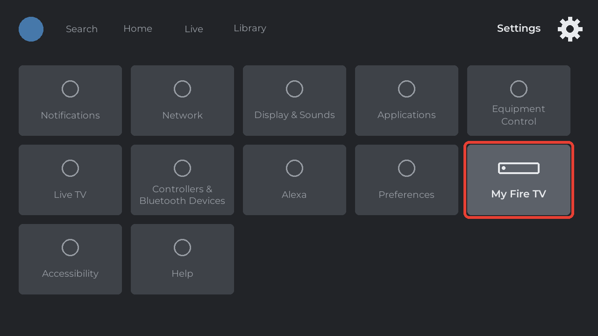
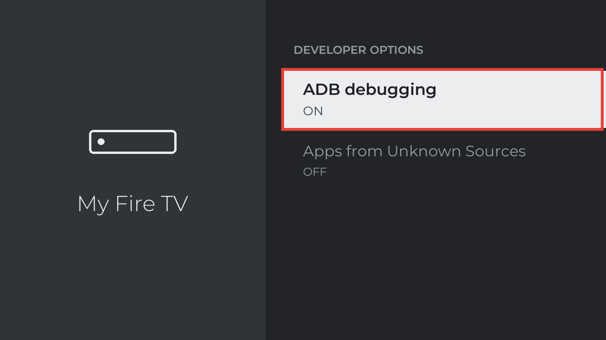

## 3. Install on the Savant host

1. Copy the `matchstick` folder to the host (for example into Downloads).
2. In Terminal on the host, **as the Savant user, not with sudo**:
   ```
   bash ~/Downloads/matchstick/install.sh
   ```
   This installs to `~/matchstick`. To use another folder: `bash install.sh ~/some-folder`.
3. Enter the Savant user's password when asked. It's needed once, to install the service and to
   add the `firetvctl` shortcut in `/usr/local/bin`.

The installer finishes with `Matchstick 1.5.1 installed and running on port 2360`.

**What it installs:**
- `~/matchstick/`: the bridge, config, logs, adb, the key helper and `firetvctl`.
- `/Library/LaunchDaemons/com.matchstick.bridge.plist`: a system service that runs as the Savant
  user, starts at boot and restarts itself if it stops.
- `/usr/local/bin/firetvctl`: a shortcut to `~/matchstick/firetvctl`.

> **Why a system service?** macOS 15's Local Network privacy blocks login items from reaching
> devices on the LAN; `adb connect` then fails with "No route to host" although ping works.
> System services aren't affected.

## 4. Pair each Fire TV

On the host:
```
firetvctl pair 192.168.1.50
```
On the TV, **Allow USB debugging?** appears. Tick **Always allow from this computer**, then
choose **OK**. The command prints `Paired. Model: ...`.

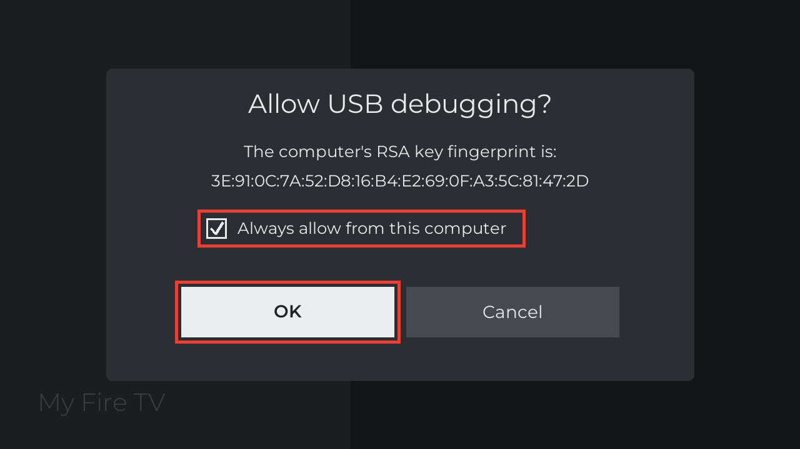

Check it:
```
firetvctl test 192.168.1.50 HOME
```
The TV goes to the home screen.

Pairing is stored on the Fire TV and survives reboots. A factory reset clears it; pair again.

## 5. Choose a profile

Both profiles are in `profile/blueprint-import/`. Use one per Fire TV.

| | **Amazon Fire TV (Matchstick)** | **Amazon Fire TV (Matchstick Keyboard)** |
|---|---|---|
| File | `amazon_fire tv (matchstick).xml` | `amazon_fire tv (matchstick keyboard).xml` |
| Savant service | Fire TV (media server) | Apple TV service (rebranded to Fire TV, section 7) |
| Pro app text pop-up | No (TypeText action only) | **Yes** |
| Pairing from the Pro app | No | **Yes** (Settings → Devices) |
| TV button double press → Live TV | No (LiveTV custom action) | **Yes** |
| Remote buttons | Full standard media remote | Apple TV style remote; extra buttons as custom actions |

Pick **Keyboard** when clients will search and type in apps. Pick the standard profile for the
fullest standard remote.

## 6. Set up in Blueprint

1. **Import the profile** into Blueprint's library from `profile/blueprint-import/`. Each
   profile there sits with its two companions, all with the same name:

   | File | What |
   |---|---|
   | `amazon_fire tv (matchstick).xml` | The profile |
   | `amazon_fire tv (matchstick).htm` | This manual, for the component's **Documentation** tab |
   | `amazon_fire tv (matchstick).icns` | The component icon |

   (The same three for the Keyboard profile, `amazon_fire tv (matchstick keyboard)`.)
   Importing the `.xml` brings in the `.htm` and `.icns` from the same folder, and Blueprint
   files them into its library itself. Keep the three together and **don't rename any of
   them**: Blueprint matches them by the profile's file name, `<manufacturer>_<model>` in lower
   case. A renamed profile still shows in the component list, but dragging it in fails with
   "Component not found".
2. Add the component to the design, one per Fire TV.
3. **Control port:** wire the component's ETHERNET port to your network switch. The **Device IP
   Address** field then appears under Control Ports. Set it to the **Savant host's** IP, or
   `127.0.0.1` since Matchstick runs on the host (it listens on port 2360).
4. **Inspector → State Variables → Fire TV IP Address:** the Fire TV's own IP.
5. Wire the HDMI output like any source.

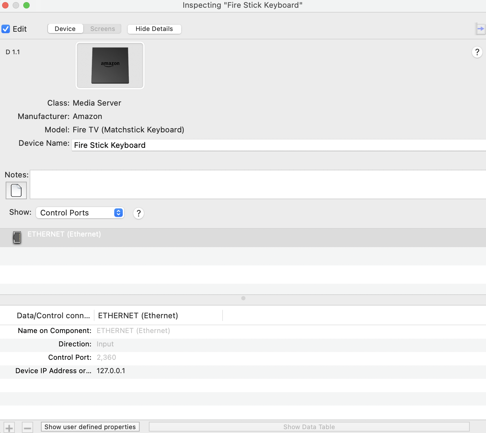
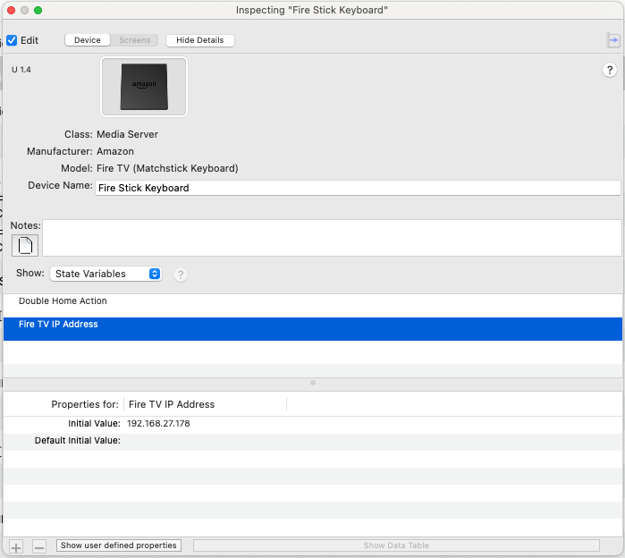

Every Fire TV component uses the same host IP. The **Fire TV IP Address** state variable tells
Matchstick which Fire TV each command is for.

## 7. Keyboard profile: Pro app setup

**Rebrand the service.** The Pro app shows this profile as Apple TV. To make it look like a Fire TV:
- In the service icon settings, set **Brand to Display** to **Amazon Fire TV**.
- In the service order list, set an alias (for example **FireTV**) for the group and each component.

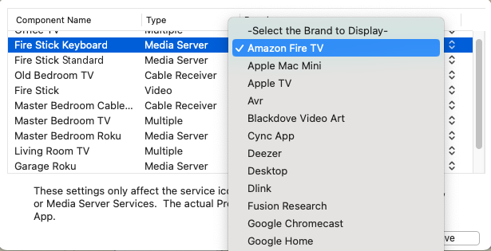
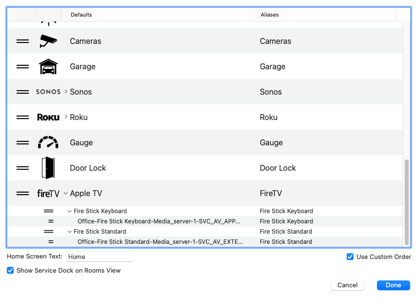

The profile sets the service's **UI Mapping** to `atv-bridge` itself (Service Preferences table);
nothing to change there.

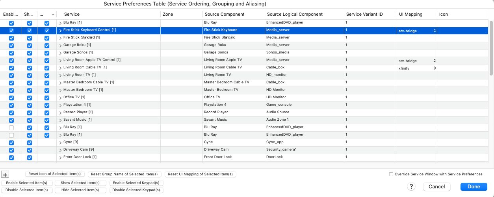

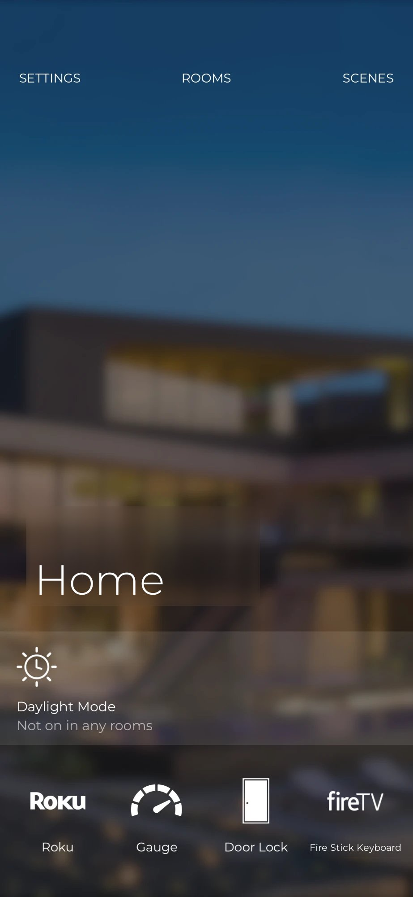

The result: the Fire TV logo on the home screen, with your alias as its label.

**Text entry.** When a text box is on the Fire TV screen (search, or an app's keyboard), the Pro
app shows its text pop-up. What's typed there replaces the box contents and is submitted; on the
Fire TV search screen this opens the results.

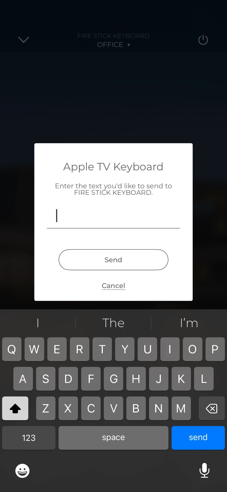

**Pairing.** The Fire TV appears under **Settings → Devices → Apple TV** in the Pro app.
- **Pair** shows *Allow USB debugging?* on the TV for a Fire TV that isn't paired yet. There is
  no PIN: approve on the TV; any PIN the app asks for is ignored.
- **Unpair** is ignored on purpose (it's logged), so a stray tap can't cut off control. To really
  disconnect a Fire TV, remove it from the design or turn off ADB debugging on it.

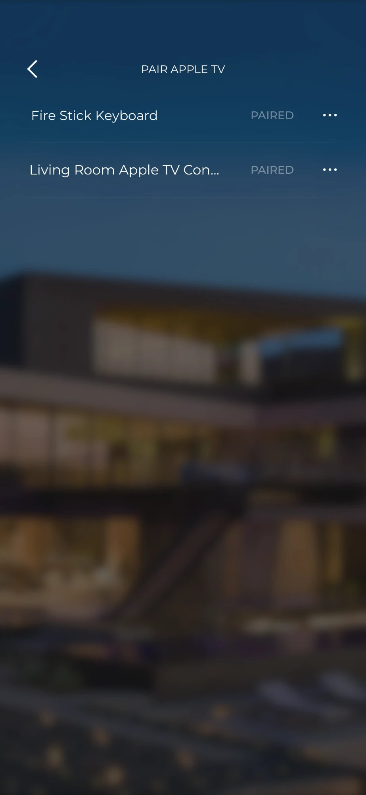

**TV button.** The app's TV button is Home. Press it twice quickly (within 0.6 s) for the
**Double Home Action**, set per component under **Inspector → State Variables**:

| Double Home Action | Double press does |
|---|---|
| `livetv` (default) | Opens the Live TV channel guide |
| `off` | Nothing extra (just Home) |
| an app alias or package, e.g. `netflix`, `com.hulu.plus` | Opens that app |
| `key:<android keycode>`, e.g. `key:172` | Sends that key |

A single press goes Home immediately; the double press is never slower.

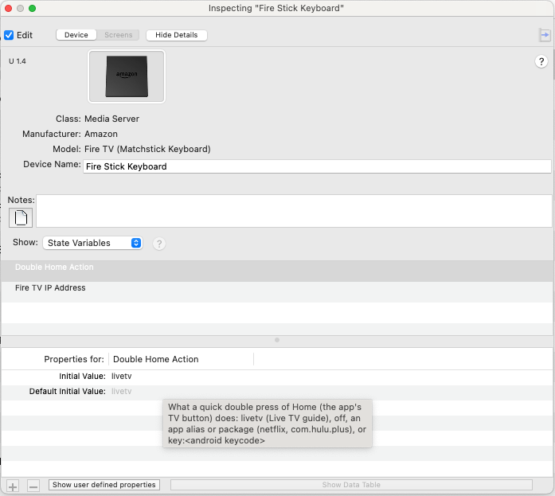

**Remote layout.** The Apple TV service has fewer buttons: **Menu** is the Fire TV Back button.
Back, Stop, Scan, Skip and Setup are available as custom actions.

## 8. Buttons, actions and states

**Standard profile service buttons:** PowerOn/Off, Home, Select, OSD cursor, Play/Pause (a
toggle, like the Fire TV remote), Stop, ScanUp/ScanDown (fast forward/rewind), SkipUp/SkipDown,
Exit/Back, Menu/Info (options), Setup (Fire TV Settings).

**Custom actions (both profiles), for buttons and workflows:**

| Action | Does |
|---|---|
| PowerToggle, PlayOnly, PauseOnly | Discrete power/play/pause |
| VolumeUp, VolumeDown, MuteToggle | Sent to the TV/AVR over HDMI-CEC (normally route volume to the AVR/TV in Savant) |
| Search | Opens Fire TV search |
| LiveTV | Opens the Live TV channel guide |
| Enter | Submits typed text; on the search screen opens the results |
| HomeLongPress | Long-press Home (quick settings and sleep menu) |
| LaunchApp | Opens an app by alias or Android package name |
| TypeText | Types text into the focused text box |
| Netflix, PrimeVideo, YouTube, YouTubeTV, DisneyPlus, Hulu, Max, AppleTV, ParamountPlus, Peacock, Plex, PlutoTV, SlingTV, Spotify, Kodi, Settings | One-touch app launch |
| Refresh, RequestAllStates | Refresh status now, or resend every value |

**App aliases** for LaunchApp: appletv, disneyplus, hulu, kodi, max, netflix, paramountplus,
peacock, plex, pluto, primevideo, settings, sling, spotify, youtube, youtubetv. For any other app,
find its package with `firetvctl apps <ip>` and use the package name, or add an alias (section 10).

**States** (for feedback and conditions):

| State | Values |
|---|---|
| ONLINE | 1 when Matchstick can control the Fire TV. Gate automations on this. |
| ADB | CONNECTED, UNAUTHORIZED (approve on the TV) or OFFLINE |
| POWER | ON or OFF (asleep) |
| APP_NAME, APP_PACKAGE | The app in front, e.g. Netflix / com.netflix.ninja |
| PLAYBACK | PLAYING, PAUSED or STOPPED |
| MODEL, FIREOS | Fire TV model code and Fire OS version |
| LAST_ERROR | Blank, or what went wrong and what to do |
| BRIDGE_VERSION | Matchstick version |
| KeyboardFocused, PairingState, PairingError, Discovered, AvailableApps | Keyboard profile only: the Apple TV service states the Pro app uses |

Known limits: on Fire OS 6, Fire TV Settings reports APP_NAME as Home. On Fire OS 8, Search opens the
search tab by moving to it (about 4 seconds); the Pro app keyboard pops up however search was
opened, the Fire TV remote included. Status refreshes every
5 seconds and about 1 second after each command.

**What working feedback looks like.** Savant's State Values window, filtered on the component
name, shows every state Matchstick reports. A healthy Fire TV reads `ONLINE 1`, `ADB CONNECTED`
and a blank `LAST_ERROR`, with the app in front in `APP_NAME` and `APP_PACKAGE`. Use these for
feedback on buttons and custom screens, and as conditions in workflows (for example, only send
a command when `ONLINE` is 1, or start a lighting scene when `APP_NAME` is Netflix).

Standard profile: the Fire TV's states, plus Savant's volume and mute states for the zone.

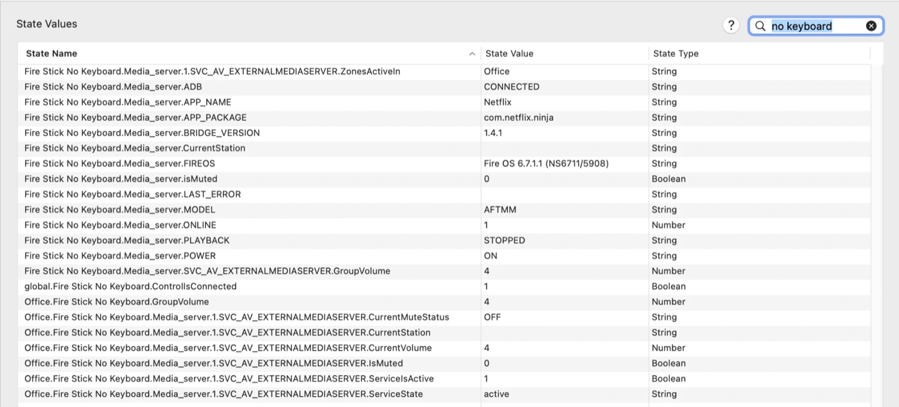

Keyboard profile: the same Fire TV states, plus the Apple TV service states the Pro app uses
(`KeyboardFocused`, `PairingState`, `Discovered`).

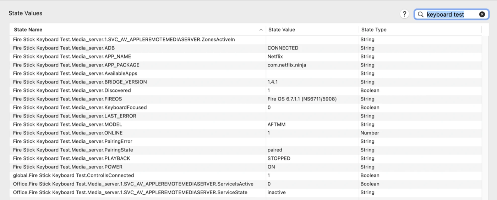

Two components can point at the same Fire TV, as here; both get the same Fire TV states. Only
the component the zone is using shows `ServiceIsActive 1`.

## 9. firetvctl

Run on the host. `start`, `stop` and `restart` ask for the Savant user's password.

| Command | Does |
|---|---|
| `firetvctl status` | Is it running and answering; which Fire TVs are paired |
| `firetvctl start` / `stop` / `restart` | Control the service |
| `firetvctl logs` | Follow the log (Ctrl-C to stop) |
| `firetvctl pair <ip>` | Approve this host on a Fire TV |
| `firetvctl apps <ip>` | List installed app package names |
| `firetvctl test <ip> <COMMAND> [arg]` | Send a command, e.g. `firetvctl test 192.168.1.50 LAUNCH netflix` |
| `firetvctl version` | Matchstick version |

The IP comes first: `firetvctl test 192.168.1.50 LAUNCH netflix`, not `firetvctl test netflix ...`.

Every command Matchstick receives is logged with the sender's port, so `firetvctl logs` shows what
Savant sent and when (routine status polls are left out).

**Test scripts** in `tools/`, for troubleshooting on site. On a host with Matchstick installed
they use the running service; elsewhere they start a temporary bridge.

| Script | Does |
|---|---|
| `bash tools/adb_test.sh <ip>` | Full check: pairing, keys, apps, Settings, sleep and wake |
| `bash tools/keyboard_test.sh <ip>` | Keyboard profile commands: text entry, clear, app list, pairing |
| `bash tools/keys_test.sh <ip>` | Navigation keys with pauses to watch the TV |
| `bash tools/grid_walk.sh <ip>`, `fast_walk.sh <ip>` | Move around a grid, slowly or quickly |
| `bash tools/launch_settings.sh <ip>` | Opens Fire TV Settings and watches status |
| `bash tools/send.sh <ip> "CMD [arg]" ...` | Send any commands and print what comes back |

## 10. Configuration

`~/matchstick/config.json`. After editing, run `firetvctl restart`.

| Setting | Default | Meaning |
|---|---|---|
| `listen_port` | 2360 | Port Savant connects to |
| `poll_seconds` | 5 | Status refresh while Savant is connected |
| `idle_disconnect_minutes` | 30 | Drop ADB to a Fire TV nobody has used for this long |
| `allowed_devices` | `[]` (any LAN address) | Lock Matchstick to these Fire TV IPs |
| `allowed_clients` | `[]` (anyone on the LAN) | Only accept connections from these IPs |
| `app_aliases` | `{}` | Extra app names, e.g. `{"tubi": "com.tubitv"}` |
| `live_tv` | `key:172` | What LiveTV opens: `key:<keycode>` or an app alias/package |
| `home_double_press_seconds` | 0.6 | Double-press window for Home; 0 turns it off everywhere |
| `stall_hold_seconds` | 600 | How long to wait for a Fire TV that stops answering before reconnecting |
| `relay_base_port` | 20000 | First local port for the per-Fire TV ADB relays (host only, `127.0.0.1`) |
| `log_level` | INFO | DEBUG logs every status poll too |

## 11. Troubleshooting

Start with `firetvctl status` and `firetvctl logs`. LAST_ERROR in Savant usually says what to do.

| Symptom | Cause and fix |
|---|---|
| `firetvctl: command not found` | You're on another computer, or the shortcut was skipped. Use `~/matchstick/firetvctl`. |
| "No route to host" pairing, though ping works | Old install running as a login item: re-run `install.sh` (1.2 and later install a system service). |
| Pairing says `unauthorized`, no prompt on the TV | Wake the TV and stay on its input. Turn ADB debugging off and on, then `firetvctl pair` again. |
| LAST_ERROR "Fire TV not answering (asleep or off Wi-Fi?) - waiting for it" | Despite the wording, the Fire TV is almost never asleep or faulty: its Wi-Fi network stopped carrying its traffic for a moment. Matchstick holds the connection and carries on when it answers. Commands sent meanwhile are dropped; send them again. Once or twice a day is normal. If it happens several times an hour, see the next row. |
| "Not answering" several times an hour, or the Fire TV drops offline for 40 s or more and reconnects | Usually the Wi-Fi channel. Fire TVs on a 5 GHz DFS channel (52 to 144) go quiet for 15 to 40 s every 10 to 30 minutes. Move the Fire TV to a 2.4 GHz network, set the access point's 5 GHz radio to a non-DFS channel (36 to 48 or 149 to 165), or use Ethernet. See **Wi-Fi** below. |
| ADB stays `OFFLINE` (log shows "shell lost"; `adb devices` shows the Fire TV as `offline`) | The Fire TV is holding an old ADB connection and refusing new ones. 1.4.1 prevents the usual cause and clears it by itself (LAST_ERROR "Fire TV is holding an old ADB connection - clearing it"). If it stays offline, turn **ADB debugging off and on**, or restart the Fire TV (a Savant-controlled power outlet can automate this). Note the time in the log for support. |
| `IP netflix not allowed` | Arguments in the wrong order. The Fire TV IP comes first. |
| Can't drag the profile into Blueprint ("Component not found") | The file was renamed. Use the original file name. |
| No Device IP Address field in Blueprint | Wire the ETHERNET port to the network switch first. |
| Documentation tab greyed out on the component | The profile was imported without its `.htm` beside it (copied in by hand, renamed, or from another folder). Import it again from `profile/blueprint-import/` (section 6). Or copy `<profile name>.htm` into the `documentation` folder of your custom profiles folder, then close and reopen the component's documentation. |
| Component shows a "?" instead of the Fire TV icon | The profile was imported without its `.icns` beside it, or the component was added before the icon was in the library; each design keeps its own copy. Import again from `profile/blueprint-import/` for new components. Copy the icon into the design's `images` folder (inside the saved `.rpmConfig`) named like the profile with an upper-case `.ICNS`, e.g. `amazon_fire tv (matchstick).ICNS`, then close and reopen the design. Or remove the component and add it again. |
| Keys feel slow | `firetvctl logs` should show `key helper running` after each connect. If it says the helper didn't start, keys fall back to slower methods; restart the service. |
| CEC didn't turn the TV on | Fire TV PowerOn wakes the Fire TV; turn the TV on from Savant as usual. |
| App launch shows "not installed" | Check the package with `firetvctl apps <ip>`. |
| Pro app text pop-up doesn't appear | Only the Keyboard profile has it. The box must be on screen (KeyboardFocused true). |

**Speed.** Key presses take about 0.05 s. Matchstick keeps a small helper running on each Fire
TV (`/data/local/tmp/matchstick-keys.dex`) so no program starts per press. If it isn't running,
keys fall back to the physical remote's input device (while the remote is connected), then to
Android's `input` command (0.3 to 1.2 s per press).

**Sleep.** A Fire TV goes to sleep when the TV turns off (HDMI-CEC). Matchstick stays connected,
and PowerOn wakes it. A sleeping Fire TV still answers on the network; sleep is not what causes
"not answering" (see **Wi-Fi**).

**Wi-Fi.** "Not answering" spells come from the Wi-Fi network, not the Fire TV. Earlier
versions of this manual and the 1.4.1 notes put them down to the Fire TV napping with the TV
off; that was wrong. During a spell the Fire TV stays awake and stays joined to its access
point, but its traffic stops: ping from the host fails too. On a 5 GHz DFS channel (52 to 144)
this happens for 15 to 40 s every 10 to 30 minutes, even with a strong signal. Commands sent
during a spell are dropped, and spells over about 40 s make Matchstick reconnect. Fire TV
settings don't stop it (a wake lock and turning off Wi-Fi power saving were both tried). In testing, a Fire TV Stick 4K Max on 5 GHz channel 100 had 2 to 6 quiet spells
an hour; moved to a 2.4 GHz network on the same access point, it had one 6-second spell in
15 hours. Fixes, best first:
- Ethernet (the Cube's port, or an Ethernet adapter for a stick).
- A 2.4 GHz network for the Fire TVs.
- A non-DFS channel for the access point's 5 GHz radio (36 to 48 or 149 to 165).

The Fire TV's IP stays the same when it changes network on the same subnet (DHCP reservation),
so Matchstick reconnects by itself. To check the channel, look up the Fire TV in the access
point's client list, or run this on the host, with the relay address that `firetvctl status`
shows next to the IP:
`~/matchstick/platform-tools/adb -s 127.0.0.1:<relay port> shell dumpsys wifi | grep -m1 mWifiInfo`
(Frequency 5260 to 5720 MHz is a DFS channel; 2412 to 2472 is 2.4 GHz).

**ADB relay.** adb on the host reaches each Fire TV through a small relay inside Matchstick
(`127.0.0.1`, from port 20000), which holds the Fire TV's one ADB connection through quiet spells.
`firetvctl status` shows it next to the IP. To use `adb` by hand while the service runs, go
through `firetvctl` (`pair`, `apps`, `test`); connecting straight to `<ip>:5555` from another
computer is refused while Matchstick holds the connection.

## 12. Upgrade and uninstall

**Upgrade:** copy the new `matchstick` folder to the host and run its `install.sh` with the same
folder as before (for example `bash install.sh` or `bash install.sh ~/adb-test`). Pairings,
`config.json` and logs are kept. Then import the new profiles into Blueprint from
`profile/blueprint-import/` and refresh the components. Blueprint only updates a component when the profile's version is higher than the one
in the design (this release is profile version 1.5). Upgrading from 1.1 or earlier also replaces the old login item with the system service.

**Uninstall:**
```
bash ~/matchstick/uninstall.sh            # add --keep-config to save config.json first
```
It removes only what the installer created, and asks for the password to remove the service and
the shortcut. Nothing in Savant is touched. The key helper file on each Fire TV
(`/data/local/tmp/matchstick-keys.dex`, 3 KB) is left; it's removed by a factory reset, and it does
nothing on its own.

## 13. Security

ADB gives full control of a Fire TV, so:
- Matchstick only accepts its fixed list of commands, and only for private (LAN) addresses.
- Lock it down further with `allowed_devices` and `allowed_clients` (section 10).
- Approving pairing on a Fire TV trusts this host's ADB key (stored in the Savant user's
  `~/.android`). Keep the host secure, and don't approve pairing prompts you didn't start.
